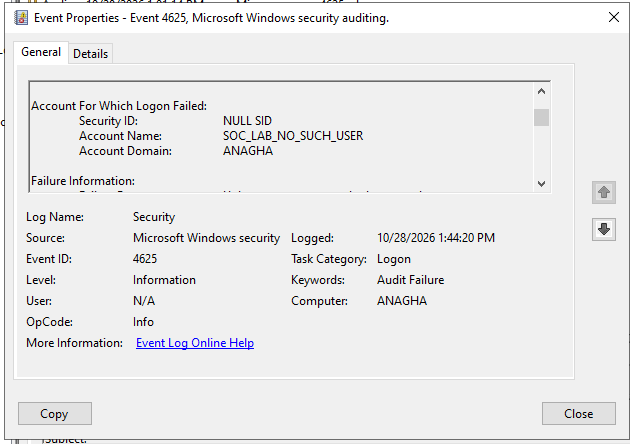
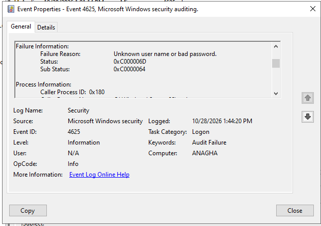

# SOC Investigation Report: Windows Failed Login

| Case detail | Value |
| --- | --- |
| Case ID | SOC-LAB-001 |
| Title | Controlled Windows Authentication Failure |
| Date investigated | October 28, 2026 |
| Environment | Windows Server 2022 virtual machine (VirtualBox) |
| Log source | Windows Security Event Log |
| Event ID | 4625 |
| Classification | Simulated authentication failure |
| Final verdict | **Benign: expected lab activity** |
| Case status | Closed (lab exercise) |

## 1. Executive summary

I generated a controlled failed login in a Windows Server 2022 virtual machine using `runas` with a nonexistent local username. Windows denied the request, and I found the related **Security Event ID 4625** in Event Viewer.

The event showed **status `0xC000006D`** and **substatus `0xC0000064`**, consistent with failed authentication because the target username did not exist. The activity was intentionally produced for training, so I classified it as **benign** rather than a malicious attack.

## 2. Objective and scope

**Objective:** Practice the core SOC workflow of generating a known event, locating it in the Windows Security log, reading key evidence fields, and reporting a justified verdict.

**Scope:** One local Windows VM and one controlled failed login. This exercise did not test real-world intrusion detection, remote brute-force attempts, SIEM ingestion, or incident containment.

## 3. Lab setup

- **Platform:** Oracle VirtualBox
- **Operating system:** Windows Server 2022 evaluation VM
- **Tool:** Windows Event Viewer, Security log
- **Test mechanism:** Windows Command Prompt, `runas`

## 4. Event generation and investigation steps

1. Opened Windows Event Viewer and navigated to `Windows Logs > Security`.
2. Ran the following command in the lab VM:

   ```cmd
   runas /user:%COMPUTERNAME%\SOC_LAB_NO_SUCH_USER cmd
   ```

3. Provided a made-up password when prompted. Windows returned:

   ```text
   RUNAS ERROR: Unable to run - cmd
   1326: The user name or password is incorrect.
   ```

4. Filtered the Security log for `4625` and refreshed the view.
5. Located the matching failed-logon event and reviewed the **Account For Which Logon Failed** and **Failure Information** sections.
6. Saved screenshots and exported the original `.evtx` evidence privately.

## 5. Evidence and observations

| Field | Recorded value |
| --- | --- |
| Log name | Security |
| Event ID | `4625` |
| Recorded time | October 28, 2026, 1:44:20 PM (VM local time) |
| Computer | `ANAGHA` |
| Account name | `SOC_LAB_NO_SUCH_USER` |
| Account domain | `ANAGHA` |
| Failure reason | Unknown user name or bad password |
| Status | `0xC000006D` |
| Substatus | `0xC0000064` |

**Screenshot 1: Target account**



**Screenshot 2: Failure details**



### Interpretation

- **Event ID 4625:** Windows recorded a failed logon attempt.
- **Status `0xC000006D`:** Logon failed because the user name or authentication information was invalid.
- **Substatus `0xC0000064`:** The specified user account was not found.
- **Command Prompt error 1326:** Independently confirms that the attempted `runas` authentication was rejected.

The username and event time aligned with the controlled test. This supports the conclusion that the event corresponds to the lab activity.

## 6. Triage decision

**Disposition:** Benign / expected laboratory test.

**Reasoning:** The test was initiated intentionally, the username was deliberately nonexistent, and the resulting authentication failure was expected. No evidence reviewed in this single-event exercise supports a malicious password attack.

**Impact:** No successful authentication by the test account was observed in the tested workflow. No production system was involved.

## 7. MITRE ATT&CK context

MITRE ATT&CK **T1110 (Brute Force)** describes a category of repeated password-guessing activity that can produce authentication failures. **T1110 was not observed or simulated here**: this project generated one failed login for learning purposes. The technique is included only to explain how a SOC analyst might use similar logs in a broader investigation.

## 8. Limitations and next steps

- Investigated one deliberately generated event; did not analyze multiple sources, accounts, or time windows.
- Did not use Sysmon, SIEM correlation, EDR, or automated alert rules in this exercise.
- Next steps: install Sysmon, capture process creation events, and later forward Windows logs to Wazuh/Splunk for more realistic SOC practice.

## 9. References

- [Microsoft Learn: Event 4625 (failed logon)](https://learn.microsoft.com/en-us/windows/security/threat-protection/auditing/event-4625)
- [MITRE ATT&CK: T1110 Brute Force](https://attack.mitre.org/techniques/T1110/) (context only)

---

*This report documents a controlled training exercise performed on a personally managed Windows virtual machine. The evidence images were taken from that exercise; the raw `.evtx` file is retained privately.*
